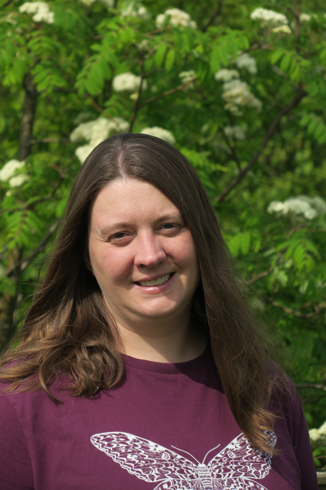

::: {.columns}

::: {.column width="30%"}

{width=100%}

:::

::: {.column width="70%" style="padding-left: 2rem;"}

# Dr Victoria J. Burton

I am interested in how soil and leaf-litter invertebrate communities respond to human impacts, particularly in forest and urban ecosystems. I am passionate about UK biodiversity, its identification and recording, and am an active member of many natural history societies.

Currently, I am a post-doctoral researcher in the [Angela Marmont Centre for UK Nature](www.nhm.ac.uk/take-part/centre-for-uk-nature.html), [Natural History Museum](www.nhm.ac.uk), London, on the [National Education Nature Park](www.educationnaturepark.org.uk). The programme aims to empower children and young people across England to make a positive difference to both their own and nature’s future. My role is planning and designing research to examine the impacts of changing land cover and habitat enhancements on biodiversity within the Nature Park, collaborating with the wider team to design community science surveys to gather the data for this and to communicate research goals and results to the participants.

Prior to this role I worked in the Biodiversity Futures Lab, increasing the amount of high-quality urban biodiversity data in the [PREDICTS](www.nhm.ac.uk/our-science/research/projects/predicts.html) (Projecting Responses of Ecological Diversity In Changing Terrestrial System) database and on [Excalibur](excaliburh2020.eu/en/) – a EU H2020 Consortium aiming to obtain a better understanding of underground soil biodiversity in horticulture. I also worked on the [LEARN CitSci](www.nhm.ac.uk/our-science/research/projects/learn-citsci.html), a UK-US partnership project researching what young people learn from taking part in museum-led citizen science projects.

I completed a BSc in Natural Sciences with the Open University in 2011 followed by an MSc in Taxonomy and Biodiversity at Imperial College London and PhD in 2020. My PhD was funded by NERC through Imperial’s Science and Solutions for a Changing Planet Doctoral Training Programme and focused on soil and litter biodiversity, investigating how the composition of these communities respond to land use change. My research used a range of methods, including collating existing data using the PREDICTS framework to build global models of soil biodiversity responses to land use and soil properties. I also collected new data on soil invertebrate diversity in different land-use types in the New Forest, Hampshire, UK and on earthworms through my citizen science project – Earthworm Watch – developed in partnership with The Natural History Museum and Earthwatch Institute, in association with the [Earthworm Society of Britain](www.earthwormsoc.org.uk). 

I am passionate about engaging the public, especially young people, in entomology and am a Trustee and Membership Administrator for the [Amateur Entomologists’ Society](www.amentsoc.org). I am a Trustee and Hon. Membership Secretary for The [Conchological Society of Great Britain and Ireland](conchsoc.org).

:::

:::